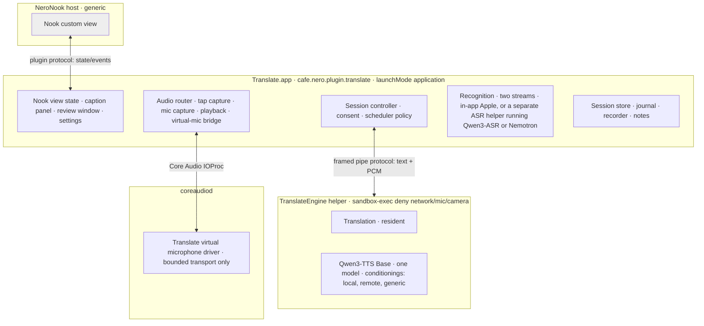
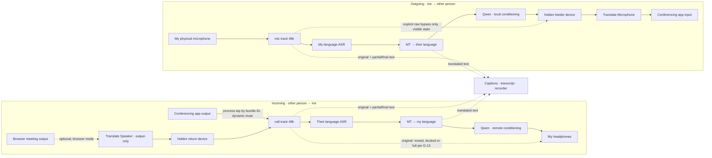

# Translate · architecture and implementation plan

**Milestone 0 deliverable · October 19, 2026 · planning only**

**Owner decisions, October 19:**
- **D‑1:** the workspace is `Development/NeroNook-Translate`.
- **D‑2:** incoming audio uses a process tap by default, with an optional output-only Translate Speaker for browser meetings.
- **D‑3:** Translate owns its driver, and the Nero Interpreter devices are not used as a stand-in.
- **D‑6:** the generic startup voice comes from synthetic reference clips made once offline with Qwen VoiceDesign.
- **D‑7:** models are acquired by download on Prepare or by hash-verified import from a user-chosen folder.
- **D‑8:** a running generation is never cancelled; it finishes and its audio is discarded. A library patch is only the fallback.
- **D‑9:** saved originals are 48 kHz mono Apple Lossless per track.
- **D‑10:** draft consent wording (§2.7) for owner edit, plus an optional spoken announcement.
- **D‑11:** this 16‑inch MacBook Pro (M4 Max, 128 GB) is the reference Mac, measured plugged in plus one pass on battery; the §6.1 pass bars are the agreed starting thresholds.
- **D‑12:** Translate defines its own evidence item, field-compatible with agent‑3's planned contract.
- **D‑13:** what the user hears when translation is not speaking follows the §2.2 table.
- **D‑14:** the four small Voice pieces are copied with provenance, plus a drift check.

Only D‑4 and D‑5 remain open, until the §6.1 comparison reports.

This plan answers the [Translate PRD](../../NeroNook/docs/TRANSLATE-PRD.md) and its [Claude Code handoff](../../NeroNook/docs/TRANSLATE-CLAUDE-HANDOFF.md). Preparing it changed nothing outside this document. In particular, it made no code, build, installation, driver, Core Audio, model, account, grant, voice profile, meeting, conferencing or Voice change. Source paths are relative to `/Volumes/Main External/Development` unless stated otherwise, and were read on October 19.

Labels used throughout:

- **Requirement** means the PRD requires it.
- **Proposal** means this plan recommends it and the owner has not yet accepted it.
- **Verified** means it was checked in source, SDK headers or read-only machine state today.
- **Unmeasured** means it is a number that no Translate code has produced yet.

---

## 0. The recommendation on one page

1. **Independent plugin.** Translate is its own native plugin, `cafe.nero.plugin.translate`, running in `launchMode: "application"`. The app owns the UI, session control, consent, audio routing and meeting storage. It vendors the shared SDK and does not import or require Voice source.
2. **One model, three voices.** A single signed MLX helper, `TranslateEngine`, keeps **one** Qwen3‑TTS 1.7B Base model resident, plus translation. It holds the **local, remote and generic voices as separately prepared reference conditionings**. The pinned mlx-audio-swift already exposes this publicly: `Qwen3TTSModel.Qwen3TTSReferenceConditioning`, `prepareReferenceConditioning(…)` and `generateStream(text:conditioning:…)`. So there is no second Qwen model and no re-encoding when switching voices. *(Verified in source.)*
   - **Cancellation.** Silence comes from the app, within 250 ms, by stopping playback and the feeder. The engine does not cancel a running generation, because the library never reports when a cancelled one has finished. It lets the current unit finish and discards its audio (D‑8, decided). The waste is bounded by the unit size and measured in M1b. A pinned library patch stays the fallback if that waste turns out to be noticeable.
   - **Recognition** runs outside the synthesis executor, so captions never wait behind speech generation.
3. **Incoming audio uses a process tap, not a virtual speaker.** Translate taps the conferencing app with a Core Audio process tap.
   - The tap follows the app's bundle IDs as its processes come and go (macOS 26 `bundleIDs` and `processRestoreEnabled`).
   - It mutes the original audio only while translated speech is available. Otherwise it un-mutes or ducks the original (D‑13).
   - Voice already captures calls with process taps.
   - **Browser meetings use a speaker device instead.** A tap applies to a whole app, so tapping a browser would mute every tab. For browser meetings such as Google Meet, Translate offers an optional **output-only "Translate Speaker"**, which the meeting page selects as its speaker.
   - *(Decided D‑2. This amends the PRD's "two devices" setup for desktop conferencing apps.)*
4. **Outgoing audio uses a Translate-owned virtual microphone.** It is an AudioServerPlugIn derived, with provenance, from the original `TimedRing` and the MIT libASPL design in the Nero Interpreter driver.
   - Desktop apps such as Teams then need only **one** Translate device, in their microphone picker.
   - The optional browser speaker is the only other visible device.
   - *(Decided D‑3: Translate-owned driver; the installed Nero Interpreter devices are not used.)*
5. **One synthesis executor with two lanes.** The two directions share one serialized synthesis executor with bounded queues and oldest-first fairness. Serialization is forced because Qwen3TTS keeps streaming-decoder state per model. *(Verified in source.)*
6. **Captions without SDK changes.** Captions run in a plugin-owned compact custom view in the Nook (`custom-views-v1`). Optional extras are a Translate-owned floating caption panel and the resizable review window. Version 1 needs no SDK change.
7. **Translate's own data format.** Sessions use a versioned format with an append-only journal. Utterance IDs never change. Source text, translation and synthesis each keep revision records. Source time and playback time are separate. Notes cite evidence per item. The format is shaped to converge later with the evidence-item contract that Voice's agent‑3 work proposes.
8. **Reuse by copying or re-implementing, never by depending on Voice.** Small, stable pieces are copied with provenance: process-tap capture, model recipe verification, wire validation and `TimedRing`. Copying is a third route next to the PRD's "negotiated service" and "separately packaged shared infrastructure"; the owner accepted it (D‑14) with a drift check that flags upstream changes. Pieces with the wrong shape for two voices are re-implemented: the renderer, the voice library and the meeting schema. **Voice is not modified.**

The biggest remaining unknowns are all measurable:

- whether embedding blending yields an audible fade (§2.4);
- sustained GPU throughput with translation and synthesis sharing one GPU;
- whether Teams accepts the virtual microphone, and whether its echo cancellation suppresses translated speech when both people overlap;
- rejecting the far end's echo of my own translated speech;
- whether Mandarin works end to end.

---

## 1. Source inventory

### 1.1 Working trees (read-only inventory before any edit)

| Tree | State on Oct 19 | Translate action |
| --- | --- | --- |
| `NeroNook` | Branch `codex/seasonal-surface-composition`. At first inventory it was @ `91590c9` with uncommitted seasonal SDK edits. Concurrent work then committed them as `76f257e`, and the tree was clean at review. | None. The SDK is read only. |
| `NeroNook-Voice` | Branch `codex/seasonal-surface-sdk`. It moved from `6169c05`, which had an uncommitted SDK snapshot, to `1600ece`, clean. | None. |
| `Development/NeroNook-Translate` | Created for this plan (D‑1). It was moved here from `/Volumes/Main External/NeroNook-Translate`. Not yet a git repository; creating one is part of M1a. | The workspace |
| Reference Mac | Mac16,5 (16‑inch MacBook Pro) · Apple M4 Max · 128 GB · macOS 27.0.1 (26A434) · Swift 6.4 | The reference machine (D‑11), measured plugged in plus one pass on battery |

Voice's agent‑3 meeting-evidence slice is committed in `4fb5b7f`, and its six files match its receipt. Its **planned next step**, structured per-item evidence in `MeetingNotebook`, overlaps Translate's notes design. Translate therefore leaves the Voice files alone and coordinates on one evidence-item shape (§2.6).

### 1.2 Qwen speech in Voice

- **Runtime.** Qwen does not run in Python. Inference runs in the Swift `--tts` role of the signed helper `NeroASR`, built from `NeroNook-Voice/Workers/Diarization` on **mlx-audio-swift @ `01dec7c9`** (MIT). The pins are mlx-swift 0.31.6 and mlx-swift-lm 3.31.4 (`Workers/Diarization/Package.swift:8`, `Package.resolved`). The worker is `Workers/Diarization/Sources/NeroNemotron/QwenWorker.swift`.
- **Models.** All modes use the **1.7B 8-bit** checkpoints. Base is `mlx-community/Qwen3-TTS-12Hz-1.7B-Base-8bit` @ `e7dd0585…` (`Sources/VoiceAudio/QwenModel.swift:12-17`, `Resources/Models/qwen-base.json`). The checkpoint is about 3.1 GB and is checked against a 12-file SHA-256 recipe. The **full re-hash runs on every fresh worker start** (`QwenSpeechRenderer.swift:20`). No 0.6B checkpoint exists in Voice.
- **Protocol.** NDJSON over stdin/stdout. Each request is ≤8 KB (`QwenSpeechSession.swift:28`). Audio comes back as base64 Float32 at **24 kHz mono**, ≤8,192 samples per frame (`ModuleCore/SpeechBackend.swift:16-36`).
- **Stray output.** The library prints debug text to stdout while preparing a reference (`Qwen3TTS.swift:273,276`). That is why Voice moves its protocol off stdout (`QwenWorker.swift:17-23`).
- **One request at a time.** Every error ends the worker. Voice has **no in-band cancel**: it sends SIGKILL to the process group, so the next request reloads and re-verifies the model (`QwenSpeechSession.swift:41-43`).
- **One cached reference.** The worker caches decoded audio for the last reference hash. The library caches the speaker embedding and reference codes, keyed by the **identity of the MLXArray object** (`Qwen3TTS.swift:18-26, 267-302`). Alternating between two references therefore re-encodes on every switch.
- **References are tied to Voice's library.** The worker accepts only `~/Library/Application Support/NeroVoice/QwenVoices/<UUID>/reference.wav` (`QwenWorker.swift:46-56`).
- **Single owner.** `QwenSpeechRenderer` keeps a static owner, and `speak()` always stops earlier speech. Playback uses one `AVAudioPlayerNode` (`QwenSpeechRenderer.swift:6,14-15,28`; `ConversationAudio.swift:9,69`).
- **ICL is always on.** Generation always uses in-context learning: reference text tokens, reference codec codes and the speaker embedding (`Qwen3TTS.swift:753-837`). An x‑vector-only mode does not exist.
- **Public API Translate can use. Verified today:**
  - `public struct Qwen3TTSReferenceConditioning { speakerEmbedding: MLXArray?; referenceSpeechCodes; referenceTextTokenIDs; resolvedLanguage; codecLanguageID }` has a **public init** (`Qwen3TTS.swift:620-640`).
  - `public func prepareReferenceConditioning(refAudio:refText:language:)` (`:597-608`).
  - `public func generateStream(text:conditioning:generationParameters:streamingInterval:)` (`:175-205`).
  - The token loop calls `try Task.checkCancellation()` on every step (`:412-413`). Ending the consuming stream reaches it through `continuation.onTermination → task.cancel()` on an **unstructured inner Task** (`:666-690`). Generation stops at its next step, but **nothing signals when the inner task has actually finished**.
  - A model-wide `speechTokenizer.decoder.resetStreamingState()` (`:406-409`) means **one generation per model instance at a time**. Without a completion signal, a fresh request could overlap a cancelled one that is still running. That is why Translate does not cancel running generations (D‑8).
  - The 2,048-byte text bound comes from Voice's request validation (`QwenWorker.swift:38`), not from the model. The library itself caps tokens at `min(maxTokens, max(75, 6×textTokens))`.
- **Measured, warm, single observations, not benchmarks.** These are probably from this M4 Max, which is named only in the October 9 report.
  - Clone first audio was 0.19–0.20 s.
  - Real-time factor was about 0.32–0.33: about 2.0 s to generate 6.24 s of audio with a 7.6 s real reference (`reports/qwen-agent-e2e-2026-10-17`).
  - Process footprint was about 3.3–3.7 GB.
  - Neither reference-switch cost nor cancel latency has ever been measured.
- **Languages.** Qwen supports English, Chinese, Japanese, Korean, German, French, Russian, Portuguese, Spanish and Italian. The request carries only the target language, so an English reference speaking Spanish is cross-lingual cloning. That is implicitly supported but untested outside English (`docs/QWEN-SPEECH.md:94`).
- **No real deletion.** The voice library can archive and restore but not delete (`QwenVoiceLibrary.swift`; `QwenStudioModel.swift:76-83`). The PRD requires real deletion.

### 1.3 Meetings in Voice

- **Capture.** Call audio is captured with a **Core Audio process tap**: `CATapDescription(stereoMixdownOfProcesses:)` wrapped in a private aggregate device (`VoiceAudio/MeetingCapture.swift:27-69`). The file is 113 lines, adapted from the owner's OmniVoice `d3b5940`. The global variant excludes only Voice's bundle. The microphone uses an `AVAudioEngine` input tap.
- **Clock.** Both tracks share one `systemUptime` epoch. On resume, paused wall-clock time is collapsed.
- **Writer.** Every track is converted to **16 kHz mono** in 15 s CAF chunks. Only each chunk's first-buffer time is recorded. Queue overflow **fails the recording** instead of recording a gap (`MeetingAudio.swift:23,42,81`).
- **Schema.** `MeetingTranscript` has **no schema version**. Its validation is closed: tracks must be `"mic"`/`"system"` and providers must be in a closed ASR enum. Re-assignment mints **new utterance UUIDs**. A correction is a single overwrite (`ModuleCore/MeetingTranscript.swift:31-133`).
- **Evidence and staleness.** Evidence is an **integer index** into the sorted utterances. Staleness is one **whole-transcript SHA‑256** (`MeetingEvidence.swift`, `MeetingNotebook.swift:26-34`). Any translation write would make every note stale.
- **Checkpoints.** The newest snapshot wins and is rewritten as a whole file at most every 2 s. There is no journal (`MeetingTranscriptCheckpoints.swift`; `MeetingLiveState.swift:103-111`).
- **Summarizer.** Apple FoundationModels on device, with structured output, source-ID validation and a circuit breaker (`VoiceAudio/MeetingSummarizer.swift`). Behaviour on non-English input is unverified.
- **Live recognition.** Live recognition already runs **one `SpeechAnalyzer` per track concurrently** (`VoiceAudio/MeetingLiveTranscriber.swift:11,52`), which is the same two-stream shape Translate needs.
- **Packaging.** `ModuleCore` is a plain target, not a library product. Its error type `VoiceProblem` and its store paths are Voice-specific, so extraction would require changing Voice.

### 1.4 Earlier interpreter and driver

- **Pipeline.** Nemotron 3.5 ASR streaming 0.6B, run through the NeroASR helper in **file mode**, then Hy‑MT2 1.8B 4‑bit through mlx-lm (Python), then Kokoro‑82M through mlx-audio. Each request **loads and unloads its model**, there is no VAD, and clips are whole files of at most 30 s (`Workers/Interpreter/engine.py:14-22,31`, `check.py:56`).
- **Timings.** About 2.0–4.5 s per phrase, summed **after a complete clip existed**. That excludes speaking time, endpointing, startup, playback and network. MT was mostly model load (0.74 s); resident first token was 0.10 s. Only two synthetic phrases were tested, and the hardware is unnamed. **This says nothing about live-call delay.**
- **Licensing risk.** Kokoro's Spanish G2P uses espeak-ng through `phonemizer-fork`, both GPL‑3.0. No document mentions this. Translate drops Kokoro.
- **Usable live front end.** `NeroASR --meeting-stream` (`Workers/Diarization/Sources/NeroNemotron/main.swift:21-112`) has two tracks, an energy VAD, 560 ms chunks, 0.7 s endpointing and partial/final events.
- **Driver.** `Drivers/NeroInterpreterAudio` is a libASPL (MIT) AudioServerPlugIn with original `TimedRing.hpp`. It contains no BlackHole code (`PROVENANCE.md:110-117`).
  - **Devices.** Two devices, *each a loopback with both an input and an output stream*, at fixed 48 kHz stereo Float32. `CanBeDefault` is false.
  - **Lease.** An unauthenticated 500 ms lease property `'nrle'`; expiry bumps an epoch so old audio is never replayed.
  - **Packaging.** Unsigned pkg, Apple Development code signature, no upgrade or uninstall path.
- **Current machine state (verified read-only).**
  - `NeroInterpreterAudio.driver` (Sept 30) is in `/Library/Audio/Plug-Ins/HAL/`. Its code signature is valid, and its executable hash matches `install-diagnosis.json`.
  - Since coreaudiod restarted at boot on Oct 17, **"Nero Interpreter Microphone" and "Nero Interpreter Speaker" enumerate** in `system_profiler`.
  - Live IO, `--self-test` and Teams routing have **never been verified**.
  - `LIVE-INTERPRETER.md` ("no virtual driver installed") and `install-diagnosis.json` (`devicesEnumerated: false`) are now stale.

### 1.5 SDK and plugin structure

- **Captions.** `PluginTransientCaption` is **host-drawn and single-stream**: one title, text and detail, text ≤1,200 bytes. The host presenter shows **one caption across all plugins** (`NeroNook/Sources/NeroNook/Modules/TransientCaptionPresenter.swift:21-59`). It cannot carry Me/Other lines with original and translated text and revisions.
- **Speech actions.** `speak_text` and `speech_conversation` take no voice, language or route parameter, and audio never crosses the bus (`SDK/CONVERSATION-STREAM.md:29-30`). Voice **cannot** synthesize for Translate into a virtual microphone.
- **Compact surface.** `custom-views-v1` is plugin HTML/JS in WebKit. State is ≤64 scalar keys or ≤32 KiB. Events are ≤30/s and ≤32 KiB with ≤16 values (`PluginWebSurface.swift:229-234`). The view has no network or microphone (`SDK/CUSTOM-VIEWS.md`, `PluginCustomView.swift:9-33`). This is the only production way to draw a custom compact surface.
- **Windows.** `PluginWindows.show(_:title:size:content:)` provides a resizable SwiftUI window. Plugin-owned `NSWindow`/`NSPanel` also works.
- **Host shutdown.** A host crash, update or quit terminates Translate after a 2 s grace period (`SDK/NATIVE-PLUGINS.md:55`).
- **Hidden devices.** libASPL already supports hidden devices (`NeroNook-Voice/Vendor/libASPL/include/aspl/Device.hpp:505-513`, `SetIsHidden`).
- **Helper processes.** Voice already maps nested helper apps to their outer app bundle (`NeroNook-Voice/Sources/VoiceAudio/MeetingProcessActivity.swift:42-56`).
- **Launch.** `launchMode: "application"` makes Translate's own bundle the TCC owner for the microphone and audio capture (`SDK/NATIVE-PLUGINS.md:49-57`).
- **Bounds.** Messages are ≤128 KiB. 15 s without a heartbeat stops the plugin. Packages are ≤128 MB, ≤4,096 files, no symlinks. Models are downloaded into app support, as Voice does.

### 1.6 Other Qwen models in the pinned runtime (verified Oct 19)

The same mlx-audio-swift and mlx-swift-lm pins already carry Qwen recognition and text models. The first draft of this plan overlooked them.

- **Qwen3‑ASR** (`Sources/MLXAudioSTT/Models/Qwen3ASR/`, 2,867 lines). The README lists 0.6B and 1.7B checkpoints at bf16, 8‑bit, 6‑bit and 4‑bit.
  - `generate(audio:)` and `generateStream(audio:…)` take a **complete clip** and stream tokens from it, chunking internally (`Qwen3ASR.swift:56-70,156,1373`). At this pin there is **no incremental live session** like `NemotronASRStreamSession.step/finish` (`NemotronASRStreamSession.swift:145-159`). The encoder has `encodeSingleWindow` "for streaming" (`:640-650`), so the building block exists, but nothing wraps it yet.
  - A `context` parameter biases recognition toward supplied text (`:64`). That is a direct fit for names and terms.
  - It detects the language itself from the model's own `language …` prefix (`:1088-1106`), with aliases such as `zh → Chinese`.
  - **Qwen3‑ForcedAligner 0.6B** gives word timestamps and handles mixed Chinese text (`Qwen3ForcedAligner.swift:92-107`).
- **Qwen3 and Qwen3.5 text models** are registered in mlx-swift-lm (`LLMModelFactory.swift:42-47`), with a preconfigured `qwen3_5_2b_4bit` (`:261`). That makes a context-aware Qwen translation candidate possible **with no port**, unlike Hy‑MT2.
- **Qwen3‑TTS Base** variants other than the 1.7B 8‑bit that Voice uses (0.6B, bf16) have never been listened to here. The handoff says not to *assume* a smaller model meets the bar. Measuring it is allowed.

---

## 2. Architecture

### 2.1 Processes



| Process | Owns | Never does |
| --- | --- | --- |
| NeroNook host | Shelf, generic plugin lifecycle, custom-view presentation, appearance | Know any Translate concept; host captions are not used in v1 |
| `Translate.app` | UI, session state machine, consent, scheduling policy, audio IO (tap, mic, playback, virtual-mic writer), resampling, recognition when Apple SpeechAnalyzer is chosen, persistence, exports, notes | MLX inference |
| `TranslateEngine` | Resident MT and Qwen models, conditionings, serialized GPU work, streamed PCM out | Audio devices, network, files outside its model and voice directories, recognition |
| `TranslateASR` (only if D‑4 picks Nemotron or Qwen3‑ASR) | Two streaming recognition sessions | Synthesis. A separate process keeps captions from waiting behind phrase generation. |
| Translate driver | Lease-gated rings: hidden feeder → visible microphone, and in browser mode only, visible speaker → hidden return | Inference, resampling, persistence, any connection between the two rings |

Why the parts are split this way:

- **Audio IO stays in the app.** That follows Voice's proven pattern: TCC is attributed to the app bundle, and the real-time callbacks only copy into lock-free rings.
- **All MLX work lives in one helper.** One process means one Metal context, one memory budget and one place to arbitrate GPU work.
- **The engine can crash safely.** A crash costs speech, not captions or the recording. The app restarts the engine and re-prepares the conditionings (§2.8).
- **Engine protocol (Proposal).**
  - Length-prefixed frames: a JSON header plus an optional binary Float32 payload. This avoids Voice's 33% base64 overhead and its 8 KB request ceiling.
  - Versioned `hello`/`ready`, request IDs, an explicit `cancel {id}`, a per-lane `flush`, `prepareVoice {slot, reference, transcript}` and health/heartbeat messages.
  - Strict validation in the style of `QwenSpeechWire`, copied with provenance.
  - Protocol frames travel on a **private duplicate of stdout** taken before anything loads, with stdout itself pointed at stderr, because the library prints to stdout.
- **Optional second helper.** A separate `TranslateMT` helper is needed only if Hy‑MT2 is chosen **and** no Swift port exists (§2.3, D‑5).

### 2.2 Audio routing



**Incoming (Decided, D‑2).**

- The conferencing app keeps its normal output device, the user's headphones.
- Translate taps that app's audio with a process tap.
  - **Selecting the processes.** Teams starts and restarts audio processes as calls start and rejoin, so a one-time snapshot is not enough. Use the macOS 26 `bundleIDs` and `processRestoreEnabled` (`CATapDescription.h:131-136,162-167`). Map nested helpers to the outer app as Voice does. Fall back to watching the process list and replacing the tap's description on the live tap through `kAudioTapPropertyDescription` (`AudioHardware.h:2010-2021`).
  - **Muting the original.** `muteBehavior = CATapMutedWhenTapped` applies only while the incoming lane can actually speak. In every other state Translate either rewrites the tap description or plays the captured original itself, according to the D‑13 table below.
  - The relevant constants are verified in `CATapDescription.h:20-33,169-173`.
- **What the user gains:** Teams shows no Translate speaker; if Translate stops or crashes, the tap ends and the user hears the call again (fail-open to the original rather than to silence); and incoming audio needs no driver.
- **Costs and risks:**
  - Teams ringtones and notification sounds go through the same tap.
  - It requires the "Screen & System Audio Recording" permission.
  - **Teams echo cancellation still uses the original remote audio as its reference.** When both people overlap, which the translation lag makes more likely, Teams may suppress or distort my outgoing translated speech. M2 and M3 include an overlap test.
- **Browser mode (optional).** A tap on a browser would mute every tab, so browser meetings use the Translate Speaker instead.
  - The user turns on browser mode and selects "Translate Speaker" as the meeting's speaker in the browser.
  - The app reads that audio from a **hidden return device** paired with the speaker, by UID, and it becomes the call track.
  - **Failure behaviour differs from the tap.** If Translate stops, the browser keeps playing into a device with no listener, so the user hears nothing until they switch the meeting's speaker back. The setup screen and the Stop banner say so.
  - The tap remains the default for desktop apps such as Teams and Zoom.

**What I hear when translation is not speaking (Decided, D‑13).**

| State | What I hear | Why |
| --- | --- | --- |
| Normal | Translated speech only; the original is muted by the tap | the product |
| Engine down, not ready, or restarting | **Full original, automatically**, with a banner | never deaf to the call |
| Behind (backlog) | Translated speech with the original **ducked underneath** at about −18 dB | I can tell they are still talking, and when they stop |
| I mute translated audio | **Full original** by default; silence if chosen | muting translation usually means "let me hear them" |
| Stop | Original (the tap ends) | fail-open |
| Browser mode | The same rules, but Translate itself passes the captured original to my headphones in the "original" states, because the speaker device has no fail-open | |

- One setting: **When translation isn't speaking: Original / Quiet original / Nothing**, default Original. The Behind state always ducks.
- **Mechanics.** "Full original" on a desktop app means the tap is switched to unmuted. "Ducked" means the tap stays muted and Translate plays the captured original itself at the reduced level, so the two can be mixed. In browser mode, both are Translate playing the captured audio through.
- Silence is never left unexplained; a banner names the state.

**Outgoing (Decided, D‑3).**

- One Translate-owned AudioServerPlugIn exposes:
  - a **visible input-only device**, "Translate Microphone";
  - a **hidden output-only feeder device** (`kAudioDevicePropertyIsHidden`, constant verified in `AudioHardwareBase.h:716,757`). The app opens it by UID;
  - **for browser mode only**, a visible **output-only "Translate Speaker"** and its hidden input-only return device.
- **The browser pair appears only while browser mode is on.** libASPL can add and remove devices at runtime (`Plugin.hpp:107-113`), but a live HAL has not confirmed that. If runtime add/remove proves unreliable, the speaker stays permanently visible as an output-only device with a clear name.
- **What each picker shows.** Every visible device has a single direction: the microphone is input-only and the speaker is output-only. A conferencing app therefore lists Translate Microphone only among microphones and Translate Speaker only among speakers. That removes the loopback-in-both-pickers mistake the current Nero driver allows.
- **The routes stay separate inside the driver.** The microphone path (feeder → microphone) and the speaker path (speaker → return) are separate rings with separate leases and no internal connection between them.
- **Needs a test:**
  - whether apps honour `IsHidden`;
  - whether a hidden device accepts a client IOProc;
  - whether runtime device add/remove behaves in Core Audio and in open browser and Teams sessions.
- Lease and epoch semantics copy `TimedRing` with provenance. Without a live lease the feeder writes are dropped and the microphone reads silence. Stop bumps the epoch. Each lease is bound to an owner token held by Translate, not an open property.
- **Identity.** New bundle ID, factory UUID, device names and UIDs (for example `cafe.nero.translate.microphone.v1`), so the driver coexists with Voice's installed Nero Interpreter driver. That driver is left untouched; whether to keep it is a separate decision.
- **Installation is an M2 step needing explicit approval.** It requires an admin password and a Core Audio reload, which drops all audio for a few seconds, so it happens outside any call.

**Isolation rules (Requirement → design).**

| Rule | Mechanism |
| --- | --- |
| Generated speech never becomes source speech (local) | The tap targets only the conferencing app's processes, never Translate's own. A global tap must exclude Translate's bundle (Voice's global tap excludes only Voice). The mic ASR adds a playback-aware guard: segments overlapping incoming playback whose text matches recently spoken translations are flagged, not translated. Headphones are the first qualification. |
| The far end's echo of my translated speech is never treated as their speech | The remote person's setup may echo what I sent, 1–2 s after I stop. Incoming recognition and reference learning keep a history of recent virtual-microphone output. A segment is flagged and kept out of translation and learning if any of these hold: (a) it falls inside a configurable round-trip window after outgoing playback; (b) its text matches a recent outgoing translation; (c) its speaker embedding is closer to my voice than to the remote reference. Flagged segments are logged and visible in review. |
| Incoming speech never reaches the virtual microphone | Typed route handles: the incoming player node is bound to the physical output only, and only the outgoing lane and the explicit bypass can write the feeder. In the driver, the speaker → return ring and the feeder → microphone ring are distinct, with no internal connection. A route-isolation unit test plus a HAL test with tones (§6, M2). |
| Silence on failure | Lease expiry 500 ms, epoch bump on Stop, mute, device loss and engine restart. Playback nodes stop on the epoch. Late PCM carrying a retired request ID or epoch is dropped. |
| No global default changes | Never write `kAudioHardwarePropertyDefault*`. The route check only reads what Teams selected (where observable) and plays and records test tones on Translate's own devices. |

**Control semantics (Requirement → design).** Language and device controls stay reachable during the session. Changing either ends the current phrase cleanly, records a gap and journals the change.

| Control | Capture | Speech | Recording | What each person hears |
| --- | --- | --- | --- | --- |
| Start / Stop | Starts or stops both lanes | Stop cancels and clears everything; late audio is dropped by epoch | Stop finalizes; nothing-saved sessions are purged | After Stop: I hear the original call (tap ended); the other person hears silence on the Translate microphone until they or I change devices, and the interface says so |
| Mute my microphone | Mic capture stops; a mic-track gap is recorded | Outgoing queue flushed; feeder silent | Mic track gap | Other person: silence. Me: incoming translation continues |
| Mute translated audio (incoming) | Unchanged | Incoming speech generation pauses; captions continue | **Unchanged.** An enabled call recording continues | Me: the full original by default, or silence if chosen (D‑13). Other person: unaffected |
| Record Pause / Resume | Unchanged | Unchanged; live translation continues | Durable audio **and** transcript saving stop. The journal records only gap and state events, with no text or audio. | Unchanged |
| Raw microphone bypass (explicit) | — | Original mic is sent to the feeder; visible state | Unchanged | Other person hears my untranslated voice |
| Conferencing app's own mute | Not observable | — | **Does not stop Translate's recording.** The interface states this next to Record. | Per that app |

**Formats.**

- Capture runs at the device's native rate and is converted in user space: 16 kHz mono for ASR, 24 kHz mono for reference learning, and native rate for recording.
- Qwen's 24 kHz output is resampled to 48 kHz for the feeder and to the output device's rate (96 kHz on the Odyssey Ark here) for playback.
- Drift: the virtual device runs on host time and physical devices on their own clocks. Phrase-level playback with bounded rings tolerates drift. Continuous passthrough (raw bypass) needs ring-level compensation, to be measured.

### 2.3 Per-direction speech pipeline

Each lane runs **capture → recognition → commit → translation → synthesis → playback**. Each lane has its own utterance state, epoch and cancellation.

- **Recognition (D‑4, open; decided by the §6.1 comparison).** Recognition **never runs behind the synthesis executor**. If it did, a long phrase being generated would freeze captions for that phrase's whole generation time. Three candidates, all measured on the same owner-recorded corpus before any is chosen:
  - **Qwen3‑ASR 0.6B or 1.7B, in a separate `TranslateASR` helper.** One model covers both directions and Mandarin. Its `context` input can carry the session's names and terms, and its forced aligner gives word timestamps. At this pin it recognizes **per phrase** from a complete clip. Live captions would come from re-running recognition on the growing phrase at a fixed cadence until the endpoint; the comparison must time that. A 0.6B 4‑bit checkpoint is small enough that a separate process costs little memory.
  - **Nemotron 3.5 0.6B streaming, in a separate `TranslateASR` helper.** A true incremental session (`step`/`finish`), 560 ms chunks, proven in Voice dictation and meetings. Spanish recognized correctly in the interpreter study. Mandarin is untested.
  - **Apple `SpeechTranscriber`, in the app.** On device, per locale, and Voice already runs two at once. Spanish and Mandarin are supported but only English is installed on this Mac; the rest need a system download. No context biasing.
  - One fixed language per direction means language identification is not required, but Qwen's detection is a useful guard against a wrong language setting.
- **Commit rule (Requirement).** Only final text enters MT and TTS.
  - A phrase commits on a final ASR result after an endpoint (start at Voice's 0.7 s quiet threshold and tune it) or at a clause boundary once a phrase grows past a bound (proposed 8 s).
  - Partials update captions only.
  - Each committed phrase gets a **stable utterance ID** and `sourceRevision 1`.
- **Translation (D‑5, open; decided by the §6.1 comparison).** Three candidates:
  - **A Qwen3 or Qwen3.5 text model (for example 2B–4B, 4‑bit) in `TranslateEngine`.** Already supported by mlx-swift-lm, so no port. It takes the previous phrases from both lanes and a glossary of names in its prompt. It shares the GPU with synthesis.
  - **Hy‑MT2 1.8B 4‑bit.** Has interpreter evidence, supports Mandarin, and takes context prompts. mlx-swift-lm has **no HunYuan model** (verified), so shipping it needs a Swift port of one model file (the Python reference is 231 lines). For the comparison only, it can run through the existing interpreter environment. Its license file says Apache‑2.0; review pending.
  - **Apple `TranslationSession(installedSource:target:)`.** On device, installed on this Mac for EN↔ES and EN↔ZH (checked Oct 19). It translates each phrase alone, with no conversation context.
  - All three are scored on the same checklist: names, numbers, negation, dates, corrections and tone-bearing words, plus consistency of pronouns and names across a three-phrase window.
  - Whatever wins, the MT input includes the previous one or two committed phrases from both lanes where the provider supports it.
- **Synthesis (§2.4).** Synthesis works one translated phrase at a time. Translate sets its own text bound per unit (Proposal: ≤300 bytes, about one spoken sentence) and splits longer phrases at sentence or clause punctuation. The bound matters twice: no unit holds the executor for long, and under D‑8 a unit discarded after Stop or Mute wastes at most that unit's remaining generation time.
- **Advertising a language pair (Requirement).** A pair is offered only after recognition, translation and synthesis have each passed in **both** directions. Qwen's synthesis language list alone is not enough. English↔Spanish is qualified first, then English↔Mandarin.

### 2.4 Voice identity, scheduling and the transition

This is the central design and the point where Translate departs most from Voice.

**Conditioning cache (Proposal, built on verified API).**

- At session start the engine prepares a `Qwen3TTSReferenceConditioning` for each slot:
  - `local` from the prepared local voice, target language = their language;
  - `generic` from a generic reference, target language = my language;
  - later `remote` from the learned remote reference, target language = my language.
- The speaker embedding and reference codes do not depend on language. A language change rebuilds only `resolvedLanguage` and `codecLanguageID` through the public init. `resolvedLanguage` also selects the generation settings (`Qwen3TTS.swift:181`).
- A switch between voices is then just passing a different object. M1 measures this: switching overhead is expected to be close to zero, while preparation costs one speaker-encoder pass plus one speech-tokenizer encode.
- Conditionings live in engine memory and are rebuilt after an engine restart. A disk cache of the derived arrays is optional. If added, it counts as a derived cache: deleting the profile deletes it.

**Executor and lanes (Proposal).**

- **One serialized synthesis executor.** Qwen3TTS holds model-wide streaming-decoder state, so it can only run that way. The executor has two lanes, incoming and outgoing.
- The **unit of work is one sentence-sized unit** of a phrase (§2.3), and the executor **never pre-empts a running unit** except for Stop, Mute or flush. Between two units of my phrase, an older committed phrase from the other lane may take its turn: the lanes play to different listeners, so unit-level interleaving bounds each person's lag without garbling either.
- **Scheduling is oldest committed phrase first** across both lanes. That bounds the maximum lag for either person, instead of starving one.
- **Translation shares the engine's GPU work.** A committed phrase's translation runs at the next unit boundary, ahead of queued synthesis, because MT jobs are short (≤0.4 s budget) and speech depends on them anyway. Recognition is outside the executor (§2.3).
- **Capacity estimate (Unmeasured; assumes the measured RTF holds and nothing else competes).** At a real-time factor of about 0.33, synthesis needs about 0.33 s of GPU per second of translated speech. If both people speak continuously, synthesis alone uses about 66% of the GPU.
- **Streaming.** Streaming starts playback at the first chunk; Voice's default interval is 0.32 s. Playback is buffered per lane, so one lane's long phrase delays the other lane's start by at most that phrase's remaining generation time.
- **Backlog (Requirement).**
  - Each lane exposes its queue age and lag.
  - Above a soft bound (Proposal: 2 queued phrases or 6 s of queued source speech) the UI shows **Behind** and offers a pause request. The pause request can be a pre-rendered courtesy phrase in the other person's language, in my voice, sent only when I tap it.
  - Above a hard bound (Proposal: 20 s), synthesis does **not** silently drop anything. The UI offers "Skip speech to live". Choosing it marks the skipped utterances `omitted` in captions and in the record. Captions and translations continue in every case.

**Cancellation (Requirement: silence within 250 ms).**

- **Stop or Mute** acts in the app at that moment: it bumps the lane epoch, stops the player node or feeder writes, and releases the driver lease. Silence does not depend on the model.
- **The engine does not cancel a running generation (D‑8, decided Oct 19).** The library's inner task finishes asynchronously and unobservably after a cancel, so starting the next generation could overlap it. Instead the engine receives `cancel {id}` and **discards** that unit's remaining audio while the generation runs to completion. The executor is reclaimed when the stream finishes, with no race and no library change.
  - **Cost:** the GPU time left in the discarded unit, at most that unit's generation time (about 0.33 × its spoken length, so under 3 s for a sentence-sized unit). It is paid only after Stop, Mute or flush. *Measured October 20 (M1b receipt): 1.6–2.4 s of waste on ≈7 s utterances at RTF 0.29, with the other lane's first audio 1.9 s after the cancel on average; voice switching itself cost 0.1 ms.*
  - Queued units that have not started are dropped at once.
  - No worker restart and no model re-verification is involved.
  - **Fallback:** if the M1b receipts show the waste delays the other lane noticeably, add a small pinned mlx-audio-swift patch that exposes generation completion, with provenance, and offer it upstream. The same patch would carry x‑vector-only if experiment E3 needs it.
  - M1b measures discard-to-idle and runs a stress test: stop, then immediately start the other lane, 100 times, with no corruption, crash or stray audio.

**Remote reference learning (Requirement → design).**

- **Starts only** after Voice matching is on and the owner has confirmed the other person agreed (§2.7).
- **Source:** the original call track from the tap, before muting, converted to 24 kHz mono.
- **A segment is accepted only when all of these hold:**
  - it is voiced and at least 2 s long;
  - the local microphone shows no voice activity within ±300 ms, which rejects crosstalk;
  - the far-end echo guard (§2.2) does not flag it. This excludes the remote side echoing my translated speech. Without this check, the learner could adopt my cloned voice as theirs;
  - its level is in range, with no clipping;
  - recognition returned a final, stable transcript in their language, which Qwen ICL needs because `refText` must match the audio;
  - it is not laughter or music, i.e. recognition did not return empty.
- **Progress shown:** usable seconds collected toward about 10–15 s. No similarity percentage is shown.
- **Assembly** is compared in experiment E5:
  - the single best contiguous segment of at least 8 s;
  - versus the best segments joined in order with 150 ms gaps and a joined transcript.
- **Preparation** runs as a low-priority executor job between phrases.
- **Identity is then locked** for the rest of the session (Requirement).
- **Known caveat:** call audio is codec-compressed, so the clone may carry call-audio colouring.

**Generic startup voice (D‑6).**

- **Decided Oct 19 (D‑6): G1.** Synthetic, clearly labelled neutral reference clips, one per supported target language with two pitch ranges, cloned during the call by **the same Base model**.
  - **Making the clips.** They are produced **once, offline, at development time** with Qwen3‑TTS VoiceDesign at the same revision Voice pins (`f90d6177…`), and shipped as small bundled WAVs with their transcripts and provenance. VoiceDesign is loaded once for that, with the owner's approval, from a hash-verified import of the checkpoint (D‑7). The shipped plugin never loads it, and nothing loads it during a call.
  - **For v1:** English and Spanish, one lower and one higher pitch range each. The owner auditions and approves the clips before they ship.
  - No model swap is needed.
  - It also makes blending experiments possible.
  - Optionally, after the first two seconds of remote speech, pick the generic clip whose pitch is closer to the remote speaker's.
- **Rejected: an owner-recorded clip.** The other person would initially sound like the owner. Clips of real third parties would raise likeness and rights questions.
- **Rejected: G2,** Apple system voices. They need no GPU, but switching engines can only be a hard switch.
- **Rejected: G3,** Qwen CustomVoice presets. They are a second 3.1 GB checkpoint, and the PRD forbids swapping models during the call.

**Transition experiments (M1 offline, then M3 live).**

| ID | Method | Library change | Expected limit |
| --- | --- | --- | --- |
| E1 | Per phrase, `speakerEmbedding = normalize(lerp(generic, remote, t))` with t stepping 0.25 → 0.5 → 0.75 → 1, keeping the generic ICL codes and text | None, using the public init | The ICL codes also carry identity, so the fade may be partial |
| E2 | Staged: E1 for two phrases, then the remote ICL codes and text with a blended embedding, rising to fully remote | None | Possible audible step when the ICL source changes |
| E3 | x‑vector-only: the embedding alone, with no ICL prefix, which enables a clean embedding interpolation | **Yes:** `referenceSpeechCodes` is non-optional today. This needs a small pinned patch (the D‑8 fallback patch), mirroring upstream Qwen3‑TTS's x‑vector-only option (not yet confirmed in the Swift port) | Lower clone fidelity than ICL |
| E4 | Indicated switch at a natural pause | None | Not a fade; the UI must say so (Requirement) |

- **Acceptance** is blinded listening by the owner and familiar listeners. If nothing reads as a fade, ship E4 clearly labelled and keep gradual blending as an open requirement.

**Local voice (Requirement: prepared before the call).**

- Translate keeps **its own** voice library under `PluginStorage.directory(id:)/Voices/`. Each voice holds `reference.wav`, `voice.json` and optional derived caches. Validation follows Voice's rules: 3–30 s, a required exact transcript, 24 kHz mono normalization and hash checks.
- **Real deletion** removes the reference, the transcript and the derived caches.
- **Saving a remote voice** after a session ("Save this voice") requires its own confirmation that the other person agreed to their voice being **kept**. Agreement to voice matching during the call does not cover keeping it.
- To reuse the owner's existing Qwen voice, the user explicitly imports a WAV and transcript, for example exported from Voice's Studio or chosen in a file panel. Translate never reads Voice's directory.

### 2.5 Captions

- **Caption entry model** (TranslateCore):
  - utterance ID
  - role (`me` or `other`, or a user-entered name)
  - source and target language
  - source time
  - original text and its revision
  - translated text and its revision
  - `provisional` or `final`
  - synthesis status
  - error kind: recognition, translation or speech
- **Display choice (Requirement).** Captions can show translated text, original text or both, and can be hidden while translation continues. Each entry shows Me or Other person, or a user-entered name, plus its languages and source time.
- **Nook surface.** A `custom-views-v1` view shows two lanes and the controls: Start/Stop, Mute my mic, Mute translated audio, Captions, Record/Pause. It also shows the language pair, readiness, lag and recording state, and keeps language and device controls one step away.
  - State is a bounded JSON string holding the last N entries per lane, within 32 KiB, updated at ≤5 Hz.
  - Events are typed, and the app re-validates them.
- **Floating caption panel** (optional, Translate-owned `NSPanel`, non-activating). It keeps captions visible over Teams with no SDK change. This is preferred over the host transient caption, which is single-stream and pre-empts other plugins.
- **Review window.** A `PluginWindows` SwiftUI window for the long transcript, playback, corrections, notes and export.
- **Remote person's captions (Requirement, stated plainly).**
  - The virtual microphone carries **audio only**.
  - The other person can turn on their conferencing app's own captions for the translated speech they receive, where that app supports the language. Teams caption language behaviour in 1:1 calls is **unverified**.
  - Shared bilingual remote captions are a later extension.
- **Later, generic and optional SDK proposal.** A `transient-caption-v3` with bounded `lines[]`, plus a policy for captions from several plugins at once. It is only needed if the owner wants host-drawn captions while the Nook is hidden and Translate's panel is off.

### 2.6 Recording, transcript and notes

- **Recording is off unless chosen (Requirement).**
  - Choices: original audio plus transcript, transcript only, or nothing saved.
  - Tracks: `mic` and `call`. **Decided (D‑9): 48 kHz mono, Apple Lossless in a CAF container**, chunked every 15–30 s. This deliberately differs from Voice's 16 kHz storage so the originals stay listenable and reusable for voice learning. Estimated 300–400 MB per hour for both tracks; the review window shows storage used. M4 confirms that `AVAudioFile` writes ALAC as expected.
  - One monotonic session clock.
  - **Explicit gap records** are written for pause, device loss, capture failure and queue overflow. Overflow records a gap; it does not fail the recording as Voice does.
  - Generated audio is optional, kept separate and labelled, and records what actually reached each route.
- **Nothing saved.** Live state stays in memory, apart from a 0600 temporary folder under the plugin's own storage that holds any temporary remote reference. That folder is purged at Stop, and again at the next launch if a crash interrupted the purge.
- **Pause.** While recording is paused, no audio, text or translations are written. The journal records only pause and resume and gap events (see the control table in §2.2).
- **Durability.**
  - The `journal.jsonl` is append-only and sequence-numbered. When saving is enabled and not paused, it is flushed at phrase commit and at least every 2 s.
  - Periodic compacted snapshots.
  - Audio is written in chunk files, each with a start time and sample count.
  - Recovery replays the journal up to the last complete line, re-indexes the chunks and marks the session `interrupted`.
- **Corrections.**
  - Source corrections and translation corrections are separate revision chains.
  - Speaker-label corrections are a `speaker.revised` event. Utterance IDs never change.
  - Text that was spoken keeps the exact translation revision that produced it (Requirement).
- **Review window.**
  - Synchronized playback of the original audio.
  - Bilingual search across source and translated text, including corrections.
  - Original and translated text side by side.
  - Speaker-label correction and personal notes.
- **Deleting a meeting** removes the whole session folder:
  - original and generated audio
  - journal, transcript snapshot and notes
  - exports stored inside it
  - derived caches
  - any temporary remote reference
  
  Independently saved voice profiles are not deleted; they have their own visible delete control.
- **Notes.**
  - The provider starts as Apple FoundationModels on device, as in Voice. Its multilingual quality must be checked, and it is selected explicitly.
  - Notes are written in my language. **Evidence cites the original utterance ID, source revision, quote and time.** Translations help reading but are not the evidence.
  - Items:
    - summary
    - topics
    - decisions (agreed only when supported)
    - actions, each with an optional owner and due date only when stated, and a `proposed` or `agreed` status
    - open questions
  - "My thoughts" are kept separately.
  - Uncertain names, owners and dates carry an `uncertain` flag rather than a guess.
  - Generating notes never sends messages or creates tasks elsewhere. That always needs a separate explicit action.
  - **Staleness is per item.** Each item stores a hash over its cited `(utteranceID, sourceRevision)` pairs. A correction marks only dependent items stale. Regeneration re-checks the exact revisions before saving and offers review before replacing anything.
  - **Evidence item (Decided, D‑12):** `meetingID, utteranceID, sourceRevision, quote (≤512 bytes, in the original language), track, start, end, correctionState, speaker: me|other|unknown, language, translationRevision?`. It carries every field that agent‑3's report lists for a future shared contract: meeting/utterance/source revision, a bounded quote, track and time, correction state, and "unknown" rather than a vendor identity. The one difference is that Voice checks a whole-transcript digest while Translate checks per-item revisions. If a shared SDK contract is adopted after coordinator review, Translate converges on it without editing Voice's `MeetingNotebook`.

### 2.7 Consent and privacy

- **Separate pre-Start confirmations (Requirement).**
  - *Voice matching:* the other person agreed to having their voice learned. Without it, Translate uses the generic voice only.
  - *Recording:* the other person agreed to being recorded.
  - Each is stored in the session manifest with a timestamp. Neither implies the other. Both can be turned off during the session, and that change is journaled.
  - The owner attests the other person's agreement; Translate cannot verify it. Recording rules depend on where both people are, and the wording below is a draft, not legal advice. It is reviewed by whoever the owner trusts for that before it ships.
- **Wording (Decided, D‑10, draft for owner edit).**
  - *Learn their voice:* "Translations will sound like the other person. Turn this on only if they've agreed. Their voice is forgotten when the call ends unless you choose to save it."
  - *Record this call:* "Saves the original audio and transcript on this Mac. Turn this on only if the other person has agreed to being recorded. Recording rules differ by location; you're responsible for following them."
  - During the call, visible chips read **Learning voice** and **Recording**.
- **Spoken announcement (optional feature, D‑10).** A pre-rendered phrase in the other person's language, in my voice, is sent through the Translate microphone when I press a button, so they hear what is happening and can answer. It is never automatic, and it is journaled when used.
- **Remote voice profile.**
  - It is temporary by default and discarded at session end, together with its conditioning.
  - "Save this voice" is a separate post-session action, and saved voices can be deleted for real.
- **Processing location.**
  - All processing is local.
  - The engine runs under `sandbox-exec` with network, microphone and camera denied, as Voice does, and offline Hugging Face settings.
  - A hosted provider would need an explicit choice describing exactly what leaves the Mac. None is in v1.

### 2.8 Failure behaviour

| Event | Behaviour |
| --- | --- |
| Engine crash or timeout | Source captions continue, because recognition is outside the engine. Translation and speech show "unavailable". Queued speech is marked `failed`. The original incoming audio returns at full level, with a banner (D‑13). The engine restarts once per minute at most, and the conditionings are re-prepared. Lanes resume at the next committed phrase. |
| Conferencing app quits or the tap fails | Incoming lane stops with a banner and a gap is recorded. Outgoing continues. The tap follows rejoined processes (§2.2). |
| Host crash, update or quit (Translate terminated after a 2 s grace) | Behaves like Stop. The other person hears silence on the Translate microphone until a device is changed; the setup screen and Stop banner say so in advance. |
| Physical device lost | That lane goes silent, a gap is recorded, and the user chooses the replacement. No automatic default switching. |
| Driver absent or not loaded | Setup check fails and outgoing is unavailable. Incoming captions still work. |
| Sleep or lid close | Session stops, the recording is finalized, and the meeting is left for review. |
| Model verification fails | Start is refused, with the failing file named. |
| Host connection lost | Same as Stop. Reconnecting never resumes speech. |

---

## 3. Buildable project layout (Proposal)

```
NeroNook-Translate/
  Package.swift                 # swift-tools 6.0, macOS 26; dependency .package(path: "Vendor/NookPluginSDK")
                                # products (executables): TranslateApp, TranslateCheck
                                # targets: TranslateCore, TranslateAudio, TranslateEngineClient, TranslateApp, TranslateCheck
                                # tests: TranslateCoreTests, TranslateAudioTests
  SDK-SNAPSHOT.json             # hostBaseline, apiVersion, per-file SHA-256 (Creator `doctor` verifies)
  Vendor/NookPluginSDK/         # exact vendored snapshot taken from a clean SDK commit
  Resources/
    NookPlugin.json             # id cafe.nero.plugin.translate · launchMode "application" · apiVersion 1
    Views/live/                 # index.html, live.css, live.js (custom-views-v1)
    Models/                     # pinned recipes: qwen-base.json (same revision/hashes as Voice), mt-*.json, asr-*.json
    Licenses/                   # mlx-audio-swift (MIT), libASPL (MIT), model licenses, provenance notes
    Voices/Generic/             # offline VoiceDesign-made generic references + transcripts + provenance (D‑6)
  Sources/
    TranslateCore/              # Foundation only: schema v1, journal, revisions, scheduler policy, queue bounds,
                                # consent state, caption model, evidence/staleness. Fully testable with fakes.
    TranslateAudio/             # process tap (copied from Voice MeetingCapture with provenance, modified),
                                # mic capture, playback, feeder writer + lease, resampling, route checks, recorder
    TranslateEngineClient/      # framed protocol, process supervision, epochs, deadlines
    TranslateApp/               # @main; plugin hello/ready, heartbeat, custom-view state/events,
                                # caption panel, review window, settings, voice library UI
    TranslateCheck/             # host-free harness: protocol fixture, file-driven two-lane pipeline, timing receipts
  Engine/                       # separate SwiftPM package → Contents/Helpers/TranslateEngine (+ TranslateASR if D‑4 needs it)
    Package.swift               # mlx-audio-swift @ 01dec7c9… (same pin as Voice);
                                # mlx-swift 0.31.6 / mlx-swift-lm 3.31.4 resolved transitively
    Patches/                    # empty unless the D‑8 fallback or E3 needs a pinned patch (upstream revision, diff, provenance)
    Sources/TranslateEngine/    # main, Protocol (dedicated fd), Executor, Conditioning, Synthesis, Translation
    Sources/TranslateASR/       # only if Nemotron/Qwen3‑ASR is selected
  Driver/                       # Translate-owned AudioServerPlugIn
    Sources/                    # Driver.cpp, TimedRing.hpp (copied with provenance); feeder→microphone and
                                # optional speaker→return pairs; owner-token leases
    Vendor/libASPL/             # MIT, upstream pin recorded
    Tests/, build.py            # build + unit tests only; installation is a separate, owner-approved step
  Workers/MT/                   # only if D‑5 selects Python Hy‑MT2: pinned lockfile, sandboxed worker
  Tests/
  scripts/                      # package.py, signing.py (modelled on Voice; never install); provenance-check.py (D‑14 drift check, read-only)
  docs/                         # this plan, PROTOCOL.md, PROVENANCE.md, ACCEPTANCE.md, DATA-FORMAT.md
  reports/                      # dated evidence receipts
```

- **Builds:**
  - `swift build` builds the app and its checks.
  - `swift build --package-path Engine` builds the helper.
  - `python3 Driver/build.py` builds the driver.
  - `scripts/package.py` produces a signed bundle in `build/` and installs nothing.
- **macOS 26 is required** by SpeechAnalyzer, `TranslationSession(installedSource:)` and parity with Voice's MLX helpers. The SDK itself needs only macOS 14.
- **Package budget.** Models download on an explicit Prepare and are never bundled, which keeps the package within the host's 128 MB limit.

---

## 4. Reuse and dependency decisions

| Existing source | Decision | Mechanism and reason |
| --- | --- | --- |
| mlx-audio-swift @ `01dec7c9` (MIT) | **Depend** (SwiftPM, same pin as Voice), unpatched | A third-party package, not Voice source. Public conditioning and stream APIs cover two voices. A small pinned patch is only the D‑8 fallback (observable cancel-completion) or the vehicle for E3 (x‑vector-only). |
| Any copied Voice code | **Decided Oct 19 (D‑14): copy with provenance, plus a drift check** | Copying with provenance is neither a "negotiated service" nor "separately packaged shared infrastructure", the PRD's two named routes; the owner accepted it as a third. Policy: Translate owns its copy; `PROVENANCE.md` records the origin path and commit for each file; no sync obligation; `scripts/provenance-check.py` diffs each copy against its recorded origin, read-only, and flags upstream changes so drift is visible rather than silent. Extraction into a shared package is a separate approved task later, if ever. |
| Qwen Base model + recipe (`qwen-base.json`) | **Copy the recipe data** with provenance; same revision | Translate stores its own verified copy (D‑7, decided: download on Prepare, or a hash-verified import from a folder the user picks; on this Mac an import from Voice's model folder is an APFS clone and costs almost no space). Verify at import and on demand, not on every engine start. |
| `QwenSpeechRenderer` / `QwenSpeechSession` / `QwenWorker` | **Re-implement** | They allow a single owner, one reference, SIGKILL cancellation, only Voice's reference paths, and 8 KB NDJSON. All of these conflict with two lanes. |
| `QwenSpeechWire` validation rules | **Copy with provenance**, adapted to framed binary | Mature bounds checks: sequence, finite samples, frame limits. |
| `QwenVoiceLibrary` | **Re-implement** with the same validation and **real delete** | The PRD requires deletion. Storage must be plugin-scoped. |
| `MeetingCapture` process tap (113 lines, OmniVoice-derived) | **Copy with provenance** (owner's OmniVoice `d3b5940` → Voice → Translate), modified | Add `CATapMutedWhenTapped`, exclude Translate's bundle, keep the native rate. |
| `MeetingTranscript` / `MeetingEvidence` / `MeetingNotebook` / checkpoints | **Do not extract now. Define Translate schema v1.** | No version field, closed enums, IDs re-minted, index evidence, whole-file digest. Agent‑3 is mid-evolution, and extracting would change Voice. Converge later through a generic SDK evidence-item contract. |
| `MeetingSummarizer` approach | **Re-implement the pattern** | Keep: on-device FoundationModels, structured output, citation validation and circuit breaker. Change: cite utterance IDs, not indices. |
| `NeroASR --meeting-stream` VAD/endpoint constants | **Reference values only** | Starting tuning point: 0.7 s quiet, 560 ms chunks, 20 s maximum. |
| Interpreter MT prompt (`worker.py:25`) | **Reference** | Starting point for the Hy‑MT2 prompt. Kokoro and espeak are dropped (GPL‑3.0 risk). |
| `TimedRing.hpp`, libASPL, `BridgeCheck.cpp` | **Copy with provenance** into a Translate-owned driver | New bundle ID, factory UUID, device names and UIDs. Must not collide with the installed Nero driver. The lease needs an owner token rather than an open property. |
| Installed Nero Interpreter devices | **Not used** (D‑3) | Not a dependency and not a stand-in. They stay installed and untouched. |
| SDK `custom-views-v1`, `PluginWindows`, `appearance-v1`, `visibility-v2`, `presentation-v1` | **Use as is** | No SDK change for v1. |
| SDK `PluginTransientCaption`, `speak_text`, `speech_conversation` | **Not used** | Single-stream or no routing. Optional future generic proposals are in §2.5. |
| Voice through `actions-v1` | **Not used in v1** | No capability Translate needs. GPU coordination between Translate and Voice is a later generic "local compute busy" channel proposal. For now, document that Voice Talk during a call is unsupported. |

---

## 5. Versioned session data (outline)

Proposed directory: `~/Library/Application Support/NeroNookPlugins/cafe.nero.plugin.translate/Sessions/<UUID>/`. Folders are 0700 and files 0600.

```text
session.json        # manifest (atomic rewrite)
journal.jsonl       # append-only events, monotonically sequenced
transcript.json     # periodic compacted snapshot (derived; rebuildable from journal)
notes.json          # personal thoughts + generated notes (separate schema version)
audio/mic-0001.caf … audio/call-0001.caf …   # only when audio saving is on
audio/generated/…   # only when generated-audio retention is on; labelled
exports/            # user-initiated only
```

```jsonc
// session.json (schemaVersion 1)
{
  "schemaVersion": 1, "id": "UUID", "createdAt": "ISO-8601", "state": "live|saved|interrupted|discarded",
  "languages": { "me": "en-US", "other": "es-ES" },
  "names": { "me": null, "other": null },               // user-entered labels, not verified identities
  "devices": { "microphone": {"uid": "…", "name": "…"}, "output": {…}, "conferencingBundleID": "com.microsoft.teams2" },
  "providers": { "asr": {"id","model","revision","runtime"}, "mt": {…}, "tts": {"id":"qwen3-tts-base","model":"…1.7B-Base-8bit","revision":"e7dd0585…","runtime":"mlx-audio-swift@01dec7c9"}, "notes": {…} },
  "saving": "audio+transcript|transcript|none",
  "consent": { "voiceMatching": {"granted": true, "at": "…"}, "recording": {"granted": false} },
  "voices": { "local": {"profileID","revision","sha256"}, "generic": {…}, "remote": {"temporary": true, "readyAt": "…", "segments": [{"start","end"}]} },
  "clock": { "epochHostTime": 0, "timebase": "mach_absolute_time", "sampleRates": {"mic": 48000, "call": 48000} },
  "audioChunks": [ { "file": "audio/mic-0001.caf", "track": "mic", "start": 0.0, "frames": 0, "rate": 48000, "codec": "alac" } ],
  "gaps": [ { "track": "call", "start": 12.0, "end": 14.5, "reason": "paused|muted|deviceLost|captureFailure|overflow|engineRestart" } ]
}
```

```jsonc
// utterance (in transcript.json; created/updated via journal events)
{
  "id": "UUID",                       // stable for life; never re-minted
  "direction": "incoming|outgoing", "speaker": "other|me", "track": "call|mic",
  "sourceLanguage": "es-ES", "targetLanguage": "en-US",
  "source": { "start": 31.20, "end": 34.05 },          // session clock, source audio time
  "sourceRevisions": [ { "rev": 1, "origin": "asr", "text": "…", "words": [ {"t","s","e"} ], "at": "…" },
                        { "rev": 2, "origin": "user", "text": "…", "at": "…" } ],
  "translations":   [ { "rev": 1, "sourceRev": 1, "origin": "mt", "provider": "…", "text": "…", "at": "…" } ],
  "synthesis":      [ { "attempt": 1, "translationRev": 1, "voice": {"slot": "remote", "revision": 1, "blend": 0.5},
                        "status": "queued|generating|played|cancelled|failed|omitted",
                        "route": "headphones|virtualMicrophone",
                        "playback": { "start": 35.10, "end": 38.40 },   // separate timeline from source
                        "generatedAudio": null } ],
  "review": "unreviewed|reviewed|uncertain",          // no invented numeric confidence
  "spans": [ { "kind": "interrupted|omitted", "from": 0, "to": 12 } ]
}
```

```jsonc
// journal.jsonl line
{ "seq": 1042, "at": 34.06, "type": "utterance.committed|source.revised|translation.added|synthesis.status|gap|consent.changed|voice.ready|recording.paused|…", "utterance": "UUID", "data": { … } }
```

```jsonc
// notes.json (schemaVersion 1)
{ "schemaVersion": 1, "thoughts": "…",
  "generated": { "provider": {…}, "generatedAt": "…",
    "items": [ { "id": "UUID", "kind": "summary|topic|decision|action|question",
                 "text": "…", "status": "proposed|agreed", "owner": null, "due": null,
                 "evidence": [ { "meetingID": "UUID", "utteranceID": "UUID", "sourceRevision": 2, "quote": "…", "track": "call", "start": 31.2, "end": 34.05,
                                 "speaker": "other|me|unknown", "language": "es-ES", "correctionState": "unreviewed|reviewed|uncertain", "translationRevision": null } ],
                 "evidenceHash": "sha256(sorted utteranceID:sourceRevision)", "stale": false } ] } }
```

- **Bounds (Proposal).**
  - At most 40,000 utterances and 4.5 h per session, matching Voice's validation.
  - The live window holds the last 200 utterances. The review window paginates.
  - Journal lines are at most 16 KiB.
  - Wall-clock dates are Swift `Date` values encoded as seconds since 2001 (an exact round trip; see `DATA-FORMAT.md`). Session-clock times are seconds since the session epoch. The ISO‑8601 strings above are illustrative.
- **Upgrades.**
  - A new schema version writes `session.v2.json` next to the original, then renames atomically.
  - The originals and the journal are never rewritten in place.
- **Exports.**
  - TXT and Markdown.
  - JSON: session plus utterances.
  - WebVTT and SRT **per language track**. Source captions use the source timeline; translated captions use the playback timeline.
  - Original audio per track, plus a convenience mix.

---

## 6. Phased plan and acceptance checks

Each milestone produces a dated receipt in `reports/` that records commands, revisions, the machine and what was not verified. The owner-approval column lists actions this plan does **not** authorize.

| M | Work | Exit checks | Owner approval needed |
| --- | --- | --- | --- |
| **0** | This plan; **rights review** | Owner accepts or amends decisions D‑1…D‑14. Rights are reviewed for Qwen3‑TTS (Base and VoiceDesign), Hy‑MT2, Nemotron (NVIDIA Open Model License), mlx-audio-swift and libASPL, before any packaging (PRD M0 exit). | Location, decisions |
| **1a** | Workspace skeleton: SDK vendored from a **clean** SDK commit, manifest, `TranslateCore` schema, journal and scheduler with fakes, `TranslateCheck` protocol fixture | `swift build`. Core tests cover revision linkage, queue bounds, oldest-first fairness, cancellation epochs, all consent, saving and pause combinations (nothing-saved writes no session files), journal recovery from a truncated last line, and stale-note detection per item | Creating a git repo |
| **1b** | `TranslateEngine`: one Base model, three conditionings, framed protocol on a dedicated fd, finish-and-discard cancellation (D‑8) | File-driven runs in both directions using the owner's imported reference plus a remote test clip. Receipts record:<br>• preparation time per voice<br>• **switch overhead** when alternating (expected about 0)<br>• first audio and RTF under alternation<br>• **discard-to-idle**, and the GPU time wasted per discarded unit<br>• memory<br>• cold start, reported separately<br>Also a **100× stop-then-start-other-lane stress test** with no corruption or crash, and no restart on stop. | Importing the Qwen Base model into Translate storage from Voice's model folder (D‑7); importing the owner's reference |
| **1c** | **Engine comparison** (§6.1): recognition, translation and TTS variants, all on one owner-recorded corpus | Pass thresholds are **agreed before scoring**. Every candidate in §6.1 runs on the same clips and gets the same receipt. D‑4 and D‑5 are decided from the receipts, not before. A paired caption model is populated. **Caption latency is measured while synthesis is saturated.** | Language asset and model downloads; use of the existing interpreter environment for Hy‑MT2 measurement; recording the corpus |
| **1d** | Voice transition experiments E1–E5 offline; offline **EN→ZH identity-versus-tone probe**; run on the TTS variant that §6.1 selects | Blinded listening set; owner verdict on fade, identity and accent; cross-lingual pronunciation check by target-language listeners, including Mandarin tones, so the hardest identity/meaning conflict is known before live work | Listener participation |
| **2** | Audio IO: tap with dynamic mute and process following; Translate-owned driver (D‑3) with hidden feeder and visible mic, plus the optional speaker and return pair; route check | **(a) Tap on a local test app:**<br>• muted original and correct captured PCM<br>• dynamic un-mute and duck<br>• fail-open on stop<br>• the tap follows a process that restarts<br>**(b) Driver:**<br>• unit tests and HAL enumeration<br>• tone-in/tone-out isolation, so incoming never appears on the virtual mic<br>• lease expiry gives silence within 500 ms<br>• hidden feeder not listed in Teams<br>• speaker and return isolated from the microphone path<br>• runtime add/remove of the browser pair<br>**(c) Browser mode:**<br>• a browser meeting (for example Meet in Chrome) selects Translate Speaker<br>• other tabs keep playing normally<br>**(d) Teams:**<br>• device selection and the tap covering Teams' real audio processes<br>• **"Make a test call"** echo, to hear exactly what the remote side receives<br>• a second real endpoint, with no cross-route leakage<br>• whether overlapping speech is suppressed by Teams' echo cancellation | Driver installation and coreaudiod reload; Teams calls; capture permission |
| **3** | Two-way live conversation, remote learning, transition | **30-minute headphone call:**<br>• bounded backlog, no replay or leakage<br>• every control behaves as in the §2.2 table, including the conferencing app's own mute<br>• Stop under 250 ms<br>• generic → learning → ready states, and an identity review<br>**Scenarios:**<br>• laughter<br>• simultaneous speech and interruptions<br>• far-end echo of my translated speech, rejected by the guard and never learned<br>• device disconnect and reconnect, sleep, engine crash<br>**Receipts:**<br>• gate rejections logged<br>• timing measured from speech onset, phrase end and queue age<br>• **resources** (CPU, GPU, resident and peak memory, energy, thermal behaviour, idle recovery) for host, plugin and helpers | Live calls with consent |
| **4** | Saved meeting and bilingual review | • Separate original tracks with gaps, and Pause writing nothing<br>• 48 kHz mono ALAC chunks written with `AVAudioFile`, sized as estimated, and recovered after a crash (D‑9)<br>• crash-recovery drill: kill the app mid-call<br>• editable paired transcript where corrections never rewrite spoken history<br>• speaker-label correction, synchronized playback and bilingual search<br>• exports: VTT/SRT per language, JSON, MD and audio<br>• real deletion of everything listed in §2.6<br>• nothing-saved sessions leave no files | — |
| **5** | Notes, packaging, second app | • Notes with per-item evidence, staleness and `uncertain` flags; regenerate-with-review<br>• accessibility, Light/Dark and Reduce Motion<br>• independent package and signing<br>• lifecycle: disable, update, remove<br>• Zoom or Meet qualification<br>• full EN↔ZH qualification in both directions, with a pair advertised only after all three stages pass | Packaging identity; no publication before host 0.35.0 and an explicit release decision |

### 6.1 Engine comparison protocol (M1c)

The owner's direction on October 19: compare the Qwen speech models seriously against the alternatives before making hard choices. This protocol decides D‑4 and D‑5 and checks the TTS variants.

**Corpus (recorded, not synthesized).**
- About 20 minutes of natural speech from the owner and at least one other speaker, in English and Spanish, with a Mandarin set from a native speaker.
- Scripted lists embedded in natural sentences: names, numbers, dates, negations, self-corrections, and Mandarin tone-minimal pairs.
- Laughter, crosstalk and interruptions.
- A second copy of everything re-encoded at a low Opus bitrate, to approximate call audio.
- Ground-truth transcripts and reference translations are agreed before any scoring.

**Recognition candidates.** Qwen3‑ASR 0.6B and 1.7B (4‑bit and 8‑bit), with and without a `context` name list; Nemotron 3.5 0.6B 8‑bit streaming; Apple SpeechTranscriber. Qwen3‑ForcedAligner for timestamps.

| Measure | How |
| --- | --- |
| Accuracy | Word error rate (character error rate for Mandarin); separate scores for names, numbers and dates |
| Final-result delay | Time from phrase end to final text, per phrase |
| Partial-caption delay | Time to first usable partial; for phrase-mode engines, the cost of a re-run every second on the growing phrase |
| Under load | The same measures while Qwen TTS generates continuously in the engine |
| Robustness | Accuracy on the Opus copy versus the clean copy |
| Footprint | Per pass: CPU time and physical footprint per process, MLX active and peak memory from the helpers, and the GPU's device utilization polled from the graphics driver (no privileges); wall time per minute of speech. GPU utilization is for the whole GPU, so it is a load figure, not a per-model cost |

**Translation candidates.** Qwen3 or Qwen3.5 text model (2B–4B, 4‑bit) with context and glossary; Hy‑MT2 1.8B 4‑bit (through the existing interpreter environment, measurement only); Apple Translation.

| Measure | How |
| --- | --- |
| Meaning | Human-rated checklist: names, numbers, negation, dates, corrections, tone-bearing words |
| Consistency | Pronouns, gender and names across a three-phrase window, with and without context |
| Delay | Per phrase, model resident, with and without concurrent synthesis |
| Mandarin | Tone-bearing and classifier errors scored by a native speaker |

**TTS variants.** Qwen3‑TTS Base 1.7B 8‑bit (the version the owner has already heard), 1.7B bf16, and 0.6B, all with the same references.

| Measure | How |
| --- | --- |
| Identity and accent | Blinded rating by listeners who know the speakers |
| Cross-lingual pronunciation | EN reference → ES and ZH, ES reference → EN, rated by target-language listeners |
| First audio and RTF | Warm, per variant, alone and while recognition runs |
| Streaming interval | 0.32 s versus shorter, for first-audio delay against chunk stability |

**Pass bars (Decided, D‑11, as starting thresholds; adjustable before scoring begins, never after).**

| Stage | Bar (unmeasured until M1c) |
| --- | --- |
| Recognition | Names, numbers and dates ≥ 95% correct on the scripted set; WER ≤ 10% for EN/ES clean and ≤ 15% on the call-codec copy; CER ≤ 10% for Mandarin; final text ≤ 0.5 s after the phrase ends |
| Translation | Zero meaning inversions on negation, numbers and dates; ≥ 90% of checklist items rated acceptable; pronouns and names consistent across a three-phrase window |
| TTS | Identity ≥ 4/5 from listeners who know the speaker; pronunciation ≥ 4/5 from target-language listeners; RTF ≤ 0.5 while recognition runs |

All measurements are taken on the reference Mac (D‑11), plugged in, with one repeated pass on battery to check for throttling.

**Decision rule.** Each stage's winner must pass the agreed threshold. Where two candidates both pass, prefer the one with fewer moving parts; the owner breaks ties by listening and by reading the receipts. A choice that needs a port, a download or a system asset is recorded with that cost next to it.

Test focus, kept meaningful rather than view-mirroring:

- revision linkage
- route isolation
- queue bounds
- two-conditioning scheduling
- cancellation and epochs
- consent and persistence combinations
- recording recovery
- stale-note rejection
- frame validation on the engine protocol

---

## 7. Requirements versus proposed numbers

**Product requirements (PRD, not numbers):**

- one local and one remote person
- Qwen3‑TTS Base as the cloning foundation
- identity preserved, with words and tones taking priority
- generic voice → learning → ready, with a fade or an honestly labelled switch
- local voice prepared beforehand
- two-direction original and translated captions
- optional recording with separate originals
- local-first processing
- isolated routes
- silence on failure
- no silent dropping
- separate consents
- real deletion
- per-item evidence for notes
- independent plugin
- no publication

**PRD's proposed targets, adopted as v1 acceptance (D‑11) but still unmeasured.** The reference Mac is this 16‑inch MacBook Pro (M4 Max, 128 GB, macOS 27.0.1), measured plugged in, plus one pass on battery to check throttling. No lower-tier Mac is available, so no general-Mac claim is made.

- captions within 1 s (p50) and 2 s (p95)
- translated speech within 2 s (p50) and 4 s (p95) after a short phrase ends
- Stop or mute silent within 250 ms
- 10–15 s of usable remote speech
- a 30-minute stable call

**This plan's additional engineering budgets (Proposal, unmeasured):**

| Stage (warm, short phrase) | Budget |
| --- | --- |
| Endpoint after speech ends | 0.5–0.7 s |
| ASR final | ≤0.3 s |
| MT, resident | ≤0.4 s |
| Qwen first audio | ≤0.3 s (observed 0.19–0.20 s on a single warm run) |
| Resample and playback buffer | ≤0.1 s |
| **Total to first translated audio** | **about 1.3–1.8 s**, within the PRD's p50; outgoing adds network delay that can't be measured locally |

**Bounds (Proposal):**

- soft backlog at 2 phrases or 6 s
- hard bound at 20 s
- phrase cap at 8 s
- driver ring of 32,768 frames
- lease of 500 ms
- caption state at ≤5 Hz and ≤32 KiB

Nothing here claims lower CPU, Neural Engine use or fanless operation.

---

## 8. Decisions for the owner

| ID | Decision | Recommendation |
| --- | --- | --- |
| D‑1 | Workspace location | **Decided Oct 19:** `Development/NeroNook-Translate`, sibling to the other plugins |
| D‑2 | Incoming route | **Decided Oct 19:** process tap by default; optional output-only Translate Speaker for browser meetings. The PRD's "two devices" wording applies only to browser mode. |
| D‑3 | Outgoing transport | **Decided Oct 19:** a Translate-owned driver (visible microphone, hidden feeder, optional speaker and return pair). The Nero Interpreter devices are not used, not even as a stand-in. Their future is a separate decision; Voice is untouched. |
| D‑4 | Recognition | **Open until the §6.1 comparison reports.** Candidates: Qwen3‑ASR (0.6B/1.7B), Nemotron 3.5, Apple SpeechTranscriber. No default. Recognition never runs behind synthesis, whichever wins. |
| D‑5 | Translation, and whether Python is allowed in a Translate helper | **Open until the §6.1 comparison reports.** Candidates: a Qwen3/Qwen3.5 text model (no port needed), Hy‑MT2 (needs a Swift port to ship), Apple Translation. Python is allowed only as a measuring tool during the comparison, never in the shipped plugin. |
| D‑6 | Generic startup voice source | **Decided Oct 19:** synthetic neutral reference clips made once offline with Qwen VoiceDesign, labelled, English and Spanish, two pitch ranges, cloned by the same Base model. Not the owner's voice; not a real third party. The owner auditions the clips. |
| D‑7 | Model acquisition | **Decided Oct 19:** support both download on Prepare and a hash-verified import from a user-chosen folder. On this Mac, import from Voice's model folder (an APFS clone, almost no extra space). Translate never reads Voice's folder unless the user points at it. |
| D‑8 | Cancelling a running generation | **Decided Oct 19:** finish-and-discard, with no library patch to start. A pinned mlx-audio-swift patch is the fallback if M1b shows noticeable waste, and the vehicle for x‑vector-only if E3 is needed. |
| D‑9 | Original-audio format | **Decided Oct 19:** 48 kHz mono Apple Lossless in CAF per track, chunked (§2.6). Not Voice's 16 kHz. |
| D‑10 | Participant-permission wording and the recording notice | **Decided Oct 19:** the draft wording in §2.7, for owner edit and outside review; plus an optional, never automatic, spoken announcement through the Translate microphone. |
| D‑11 | Reference Mac and thresholds | **Decided Oct 19:** this 16‑inch MacBook Pro (M4 Max, 128 GB), plugged in plus one pass on battery. The PRD targets are v1 acceptance; the §6.1 pass bars are the agreed starting thresholds. No general-Mac claim. |
| D‑12 | Evidence-item shape shared with Voice's agent‑3 | **Decided Oct 19:** Translate defines its own item now (§2.6), field-compatible with agent‑3's planned contract, and converges on a shared SDK contract if one is adopted. Voice is not edited. |
| D‑13 | What I hear when translation is not speaking | **Decided Oct 19:** the §2.2 table. Full original when the engine is down; ducked original when Behind; full original by default when I mute translation, with silence as a choice; one setting, default Original. |
| D‑14 | Copying Voice code with provenance as a third reuse route | **Decided Oct 19:** yes, for the four small pieces in §4, with `PROVENANCE.md` and a read-only drift-check script. Extraction into a shared package is a separate task later, if ever. |

---

## 9. Risks

| Risk | Effect | Early probe |
| --- | --- | --- |
| Blending does not read as a fade | The requirement stays open | M1d listening (E1, E2, E5) before any live work |
| GPU contention among ASR, MT and TTS on one GPU | Backlog grows when both people speak | M1b/M1c alternating-load receipts; Apple ASR/MT offload as a mitigation |
| Teams ignores `IsHidden`, rejects the device or processes it badly (noise suppression, AGC) | Outgoing quality or usability | M2 Teams test call |
| Teams echo cancellation uses the original remote audio as its reference and suppresses my overlapping translated speech | Lost or distorted outgoing speech | M2/M3 overlap test |
| Teams audio processes restart or are missed by the tap | No incoming audio, or an unmuted original | `bundleIDs` and `processRestoreEnabled`, plus live description update; M2 restart check |
| Runtime add/remove of the browser speaker pair misbehaves in Core Audio or in open apps | Clutter, or a stale device in open sessions | M2 driver check; fall back to a permanently visible output-only speaker |
| A discarded generation delays the other lane | Up to one unit's generation time after Stop or Mute | M1b waste receipt; D‑8 fallback patch if noticeable |
| The far end echoes my translated speech back | Re-translation loop; wrong remote identity learned | Far-end echo guard (§2.2); M3 scenario |
| Remote reference contaminated by call codec, crosstalk or far-end echo | Wrong identity | Gate logging in M3; owner review of the selected reference audio |
| Cross-lingual accent and pronunciation (especially Mandarin tones) | Meaning errors | M1d and M5 target-language listeners |
| Model and runtime licensing (Hy‑MT2, Nemotron NVIDIA Open Model License, Qwen) | Distribution | Rights review in M0/M1 before any package |
| Concurrent Voice Qwen or ASR use | Contention | Documented as unsupported in v1; generic coordination channel later |
| A copied Voice file is later fixed in Voice | Silent divergence | `provenance-check.py` flags it; the fix is ported by hand with a provenance note |
| `AVAudioFile` does not write ALAC as expected | Recording format change | M4 first check; fall back to 48 kHz Int16 CAF (about 350 MB per hour per track) |
| SwiftPM 6.4's build system stamps the deployment target as the SDK version, and Apple Translation then reports installed language packs as `supported`/not installed (found in M1c) | Apple Translation silently unavailable in any executable built that way | `TranslateCheck` carries an explicit linker `-platform_version` and checks its own stamp (`BuildStamp`); the packaged app's stamp is a release check |
